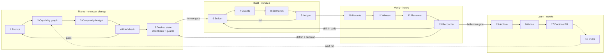

<div align="center">

<h1>Harness Engineering Lab</h1>

<p><strong>A platform, a harness, and an app built only from what its brief pays for.</strong></p>

<p>
  <a href="#quick-start">Quick start</a> ·
  <a href="#the-idea">The idea</a> ·
  <a href="#the-run">The run</a> ·
  <a href="#repository-map">Repository map</a> ·
  <a href="#where-decisions-live">Decisions</a> ·
  <a href="AGENTS.md">For AI agents</a>
</p>

<table>
  <tr>
    <td align="center"><strong>11</strong><br><sub>OSS platform services</sub></td>
    <td align="center"><strong>18</strong><br><sub>harness steps, 4 loops</sub></td>
    <td align="center"><strong>25 / 25</strong><br><sub>selection rules proven by an eval</sub></td>
    <td align="center"><strong>9 / 10</strong><br><sub>ops points spent by DeskBook</sub></td>
    <td align="center"><strong>0</strong><br><sub>LLM keys needed to run it</sub></td>
  </tr>
</table>

</div>

<h2 id="the-idea">The idea</h2>

<p>
Give a coding agent a platform with Valkey, Temporal, S3, an LLM gateway and a
worker template, and it will use all of them. This lab writes the rules that
stop it — the <em>CCoE doctrine</em> — and the <strong>harness</strong> that enforces them:
</p>

<blockquote>
<p><strong>A brick enters an app only if a requirement id pays for it.</strong>
Every choice is written down with what it rejects, the compute it avoids and
the signal that would reopen it — then checked before the edit, before the merge
and on the running stack.</p>
</blockquote>

<table>
  <thead>
    <tr><th>A requirement says…</th><th>The harness buys</th><th>…and refuses</th></tr>
  </thead>
  <tbody>
    <tr><td>“a booking can repeat <em>every week until a date</em>”</td><td>nothing — a rule read at query time</td><td>Valkey, worker, Temporal (−5 points)</td></tr>
    <tr><td>“<em>every Monday, e-mail</em> the managers the list”</td><td>Valkey + worker (a side effect needs a clock)</td><td>Temporal</td></tr>
    <tr><td>“the manager has <em>3 days to approve</em>”</td><td>Temporal + worker</td><td>Valkey</td></tr>
    <tr><td>“office managers <em>upload</em> floor plans”</td><td>a private S3 bucket</td><td><code>PUBLIC_BUCKET=1</code></td></tr>
    <tr><td>“run Llama <em>on our GPUs</em>”</td><td colspan="2">refused at the brief: the platform cannot host it</td></tr>
  </tbody>
</table>

<h2 id="the-run">The run</h2>



<details>
<summary><strong>What each step does — and where it lives</strong></summary>
<br>
<table>
  <thead><tr><th>Step</th><th>What</th><th>Where</th></tr></thead>
  <tbody>
    <tr><td>2</td><td>Rebuild the capability graph from the platform's own files; fail if a service is unpriced</td><td><code>harness/src/catalog.ts</code>, <code>harness/mcp/platform/</code></td></tr>
    <tr><td>3</td><td>Need test: text → signals → needs (unless vetoed) → bricks → bill</td><td><code>harness/catalog/criteria.yaml</code>, <code>harness/src/needs.ts</code></td></tr>
    <tr><td>4</td><td>Grade the brief on 5 points, ≤ 3 questions that change a brick</td><td><code>harness/src/brief.ts</code></td></tr>
    <tr><td>5</td><td>Decisions (serves · rejected · avoids · revisit when · scales by) compiled into guards</td><td><code>harness/src/decide.ts</code>, <code>harness/src/openspec.ts</code></td></tr>
    <tr><td>7</td><td>Prevent (PreToolUse hook) and detect (CI fitness)</td><td><code>harness/hooks/guard.ts</code>, <code>harness/src/guards.ts</code></td></tr>
    <tr><td>9</td><td>Only <code>passes</code> flips, after the task's scenarios ran green as a persona</td><td><code>harness/src/ledger.ts</code></td></tr>
    <tr><td>10</td><td>Dependency-free mutation testing on the pure domain module</td><td><code>harness/src/mutants.ts</code></td></tr>
    <tr><td>11</td><td>The platform as witness: audit log, Valkey keys, bucket ACL, namespaces, vkeys</td><td><code>harness/src/witness.ts</code></td></tr>
    <tr><td>12</td><td>Reviewer on the other model family, through <code>llm.internal</code></td><td><code>harness/src/review.ts</code></td></tr>
    <tr><td>15</td><td>Archive: spec in force, cumulative decision log, evidence pack to S3</td><td><code>harness/src/archive.ts</code></td></tr>
    <tr><td>18</td><td>26 eval cases, with vs without, rule-by-rule ablation</td><td><code>harness/evals/</code></td></tr>
  </tbody>
</table>
</details>

<h2 id="quick-start">Quick start</h2>

<p>Prerequisites: WSL2 Ubuntu (or Linux) with Podman ≥ 4, <code>podman compose</code>, Node ≥ 20 + <code>gitlab-ci-local</code>, Bun ≥ 1.1 — check with <code>core-platform/preflight.sh</code>.</p>

```bash
cd core-platform && gitlab-ci-local --force-shell-executor   # 1. the platform (≈ 2 min)
cd .. && bash harness/e2e/run.sh                             # 2. the whole harness run, end to end
```

<p>The end-to-end run plans DeskBook from its brief, deploys it, runs its scenarios as seeded personas, injects a drift to prove the guards catch it, reconciles to green, archives the decisions — and prints <code>E2E GREEN</code>.</p>

<h2 id="repository-map">Repository map</h2>

<table>
  <thead><tr><th>Folder</th><th>What it is</th><th>Read first</th></tr></thead>
  <tbody>
    <tr>
      <td><code>core-platform/</code></td>
      <td>The shared, app-agnostic platform: Valkey, OpenBao, Postgres + pgvector, SeaweedFS S3, APISIX LLM gateway, Temporal, Casdoor OIDC, Umami, Dozzle, a registry. Lifecycle through <code>gitlab-ci-local</code>.</td>
      <td><a href="core-platform/README.md">core-platform/README.md</a></td>
    </tr>
    <tr>
      <td><code>harness/</code></td>
      <td>The reconciliation harness: criteria, budgets, need test, decisions → guards, OpenSpec, ledger, witness, mutants, reconciler, archive, evals, MCP server, skills and agents.</td>
      <td><a href="harness/README.md">harness/README.md</a> · <a href="harness/doctrine/rules.md">doctrine</a></td>
    </tr>
    <tr>
      <td><code>deskbook/</code></td>
      <td>A desk-booking app built through the harness: Bun built-ins only, OIDC, private floor plans, weekly bookings read at query time. 9 / 10 points.</td>
      <td><a href="deskbook/README.md">deskbook/README.md</a></td>
    </tr>
  </tbody>
</table>

<h2 id="where-decisions-live">Where decisions live</h2>

<p>Every choice is archived so an app stays <strong>modular</strong> (the next change knows exactly which brick it may add, and on which signal) and <strong>scalable</strong> (each decision states how it grows and where that stops).</p>

<table>
  <thead><tr><th>Record</th><th>Holds</th><th>Lifetime</th></tr></thead>
  <tbody>
    <tr><td><code>&lt;app&gt;/openspec/changes/add-&lt;app&gt;/design.md</code></td><td>The open change's bill and decisions</td><td>Until the merge</td></tr>
    <tr><td><code>&lt;app&gt;/openspec/specs/&lt;app&gt;/decisions.md</code></td><td>Every decision in force: serves, chose, rejected, avoids, <em>revisit when</em>, <em>scales by</em></td><td>Permanent, in Git</td></tr>
    <tr><td><code>&lt;app&gt;/openspec/specs/&lt;app&gt;/spec.md</code></td><td>The requirements in force</td><td>Permanent, in Git</td></tr>
    <tr><td><code>&lt;app&gt;/openspec/changes/archive/&lt;date&gt;-&lt;change&gt;/run/</code></td><td>The run's decision trail and verdict</td><td>Permanent, in Git</td></tr>
    <tr><td><code>&lt;app&gt;/.harness/</code></td><td>Bill, guards, ledger — what is enforced now</td><td>Regenerated per change</td></tr>
    <tr><td><code>s3://harness/&lt;app&gt;/&lt;run&gt;/</code></td><td>The full evidence pack</td><td>Outside Git</td></tr>
  </tbody>
</table>

<h2>For AI agents</h2>

<p>Start with <a href="AGENTS.md"><strong>AGENTS.md</strong></a>: where every kind of work goes, what the harness owns, and what “done” means. Claude Code loads it through <a href="CLAUDE.md">CLAUDE.md</a>.</p>

<h2>Status</h2>

<table>
  <tr><td>✅</td><td>Frame, build, verify, archive, learn — deterministic, tested end to end on the live platform</td></tr>
  <tr><td>⏸️</td><td>Cross-family reviewer: wired, skipped until a provider key and a <code>harness</code> vkey exist (the run report says so)</td></tr>
  <tr><td>🛠️</td><td>Next (rollout V4): the run as a Temporal workflow, gates as signals; doctrine PRs opened, not just proposed</td></tr>
</table>

<div align="center"><sub>SIGL 2027 · SDIN · Harness engineering lab</sub></div>
